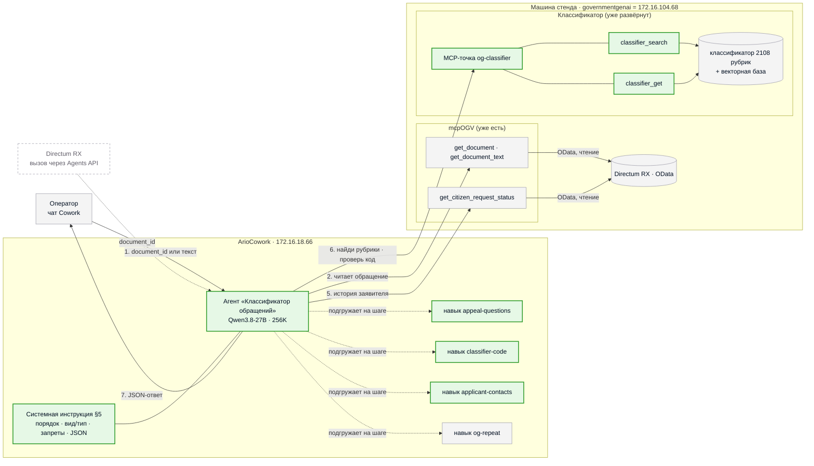

# Агент-классификатор обращений на ArioCowork — проект

Дата: 2026-10-29 · Ветка: `research/quality-followups-68` · Статус: черновик на согласование
Редакция 3: системная инструкция агента и набор навыков расписаны полностью;
`og-classifier` — MCP-точка уже развёрнутого на стенде классификатора.

## 1. Зачем

Гипотеза: классификацию обращений граждан (59-ФЗ, Общероссийский классификатор,
2108 рубрик) можно перенести из нашего жёстко зашитого пайплайна в агента на
платформе ArioCowork (LibreChat, Agents API совместим с OpenAI). Что должно стать
лучше — со слов оператора:

1. **Гибкость.** Правила классификации живут в инструкции и навыках агента и
   правятся без кода и пересборки. Сейчас каждое правило аналитика — коммит,
   тесты, обновление стенда.
2. **История системы.** При классификации агент видит прошлое в RX: прежние
   обращения заявителя, их коды и ответы. Наш пайплайн видит только текст одного
   обращения.
3. **Полный контроль над MCP RX.** Мы сами решаем, какие данные RX видит агент и
   что он в RX может сделать. MCP-сервер RX — наш (mcpOGV, репозиторий
   `MCP-Directum-RX`), дорабатываем его сами.

Проверка — вручную, силами оператора: он собирает агента в интерфейсе платформы,
подключает MCP-серверы и прогоняет обращения сам.

## 2. Цели, не-цели, анти-цели

**Цели**
- Системная инструкция агента (§5) и три новых навыка (§6), из которых в интерфейсе
  ArioCowork собирается агент «Классификатор обращений».
- MCP-точка `og-classifier` у классификатора, уже развёрнутого на стенде:
  смысловой поиск по классификатору и проверка кода (§8.1).
- Подключение готового mcpOGV (чтение RX) и готового навыка истории `og-repeat`.
- Два варианта подачи классификатора агенту для ручного сравнения (§7).
- Чек-лист ручной проверки на тех же выборках, что и пайплайн (§9).

**Не-цели (в этой итерации)**
- Запись в RX и доставка ответа агента в RX. Результат оператор видит в чате;
  мост «RX → Agents API → проверка JSON и кодов → RX» — следующая итерация.
- Доработки mcpOGV. Берём как есть.
- Поиск похожих документов, многоагентная оркестрация, расписания, блоки вызова
  агента в маршрутах RX, автоматический eval через Agents API.

**Анти-цели — провал, даже если «работает»**
- Агент выдаёт коды, которых нет в классификаторе, или код не той ступени.
- Ответ дольше 2 минут на типовое обращение.
- Агент пишет в RX или видит больше, чем нужно для классификации.
- Персональные данные из обращений уходят за пределы внутренней сети.

## 3. Ограничения и факты

- **Платформа** — внутри сети: `cowork.directum360.ru` → `172.16.18.66`. Agents API:
  `https://cowork.directum360.ru/api/agents/v1/chat/completions`,
  `Authorization: Bearer <ключ>`, `model` = ID агента (обязателен).
- **Модель** за агентом — Qwen3.8-27B (Ario), окно 256K.
- **Базовый контекст** агента «ОГВ» — ~35K токенов; один вызов MCP-инструмента
  поднял запрос до ~70K. Новый агент — без лишних вложений.
- **Инструменты из запроса не работают:** агент вызывает только инструменты,
  подключённые на платформе.
- **Ответ агента** — только текст `choices[0].message.content`; строгий JSON по
  инструкции + `response_format: json_object` работает (проверено).
- **Навыки на платформе:** имя в kebab-case, описание «когда применять», инструкции
  в markdown, файлы (zip). Модель видит описания и подгружает навык сама. Системная
  инструкция агента в контексте всегда.
- **Стенд** — одна машина: `governmentgenai.directum360.ru` = `172.16.104.68`. На ней
  Directum RX (OData, Basic-авторизация) и **уже развёрнут наш классификатор** в
  текущем исполнении (`main`, Docker).
- **mcpOGV** (`MCP-Directum-RX`, ветка `feature/mcp-ogv`): MCP streamable HTTP,
  доступ по секрету `X-MCP-Key`, учётка RX личная или служебная, запись выключена
  по умолчанию, тулы обращений не отдают адрес, телефон и email заявителя.
- **ПДн (59-ФЗ):** платформа, mcpOGV и классификатор — внутри сети. Логи
  `og-classifier` не пишут тексты запросов.

## 4. Схема

Обозначения: **зелёное — новое, делаем в этой задаче**; серое — уже есть, берём как
есть; пунктир — следующая итерация.



Порядок шагов (номера на стрелках):
1. запрос — `document_id` или текст;
2. агент читает обращение через mcpOGV;
3. выделяет вопросы (`appeal-questions`);
4. определяет ФИО и email (`applicant-contacts`);
5. смотрит историю заявителя (`og-repeat` → mcpOGV);
6. по каждому вопросу ищет рубрики и проверяет код (`classifier-code` → `og-classifier`);
7. возвращает JSON.

## 5. Системная инструкция агента

Вставляется в поле системной инструкции агента целиком. Правила взяты из
проверенного `SYSTEM_PROMPT` пайплайна (`src/classifier_agent.py` на `main`).

````markdown
Ты — агент «Классификатор обращений». Ты классифицируешь обращения граждан по
Федеральному закону № 59-ФЗ и Общероссийскому тематическому классификатору
обращений (2108 рубрик) и возвращаешь результат строго в формате JSON.

## Что тебе присылают
- номер документа Directum RX (`document_id`), или
- текст обращения прямо в сообщении.

## Порядок работы — выполняй все шаги по порядку
1. Получи текст. Если дан `document_id` — вызови `get_document` и
   `get_document_text` (сервер mcpOGV). Если текста нет (скан без текстового слоя)
   — верни JSON с `check.error`, коды не придумывай.
2. Определи вид, тип и признаки обращения по правилам ниже.
3. Загрузи навык `appeal-questions` и выдели вопросы обращения.
4. Загрузи навык `applicant-contacts` и определи ФИО и email заявителя.
5. Если заявитель определён и обращение есть в RX — загрузи навык `og-repeat`:
   выясни, повторное ли обращение, и какими кодами классифицировали прошлые
   обращения этого заявителя.
6. Загрузи навык `classifier-code` и для каждого вопроса подбери код через
   `classifier_search` и `classifier_get` (сервер og-classifier).
7. Составь краткую суть и обоснование и верни JSON.

## Вид обращения (59-ФЗ)
- **Жалоба** — просьба о восстановлении или защите нарушенных прав, свобод или
  законных интересов.
- **Заявление** — просьба о содействии в реализации прав, сообщение о нарушении
  законов, о недостатках в работе органов власти и должностных лиц, критика их
  деятельности.
- **Предложение** — рекомендация по совершенствованию законов, деятельности
  органов власти, развитию общественных отношений.
Если признаки нескольких видов — выбирай по главной просьбе обращения.

## Тип обращения
- **Индивидуальное** — от одного человека.
- **Коллективное** — от двух и более людей или от имени собрания, жильцов дома,
  с подписями нескольких человек.
- **Анонимное** — нет фамилии автора или адреса для ответа.

## Признаки (отмечай, тематику они не меняют)
- **Повторное** — «обращаюсь повторно», «ответа так и не получил», «ранее
  обращался», «на моё предыдущее обращение» — или навык `og-repeat` нашёл прошлое
  обращение по тем же вопросам в периоде повторности.
- **Отзыв** — просит прекратить рассмотрение, отозвать обращение, сообщает, что
  вопрос снят.
- **Устное** — запись личного приёма или телефонного звонка.

## Запреты
- Не выдумывай коды. В ответ идёт только код, который вернул `classifier_search`
  и подтвердил `classifier_get` (`exists = true`).
- Один код — один вопрос. Если два вопроса получили один код — это один вопрос.
- Ничего не создавай и не меняй в Directum RX — только чтение.
- Не пересказывай прошлые обращения заявителя и не выводи чужие персональные данные.
- Если инструмент недоступен или вернул ошибку — напиши об этом в `reasoning`,
  верни то, что удалось определить, и поставь `check.needs_verification = true`.

## Ответ — только JSON, без текста до и после
{
  "document_id": <число или null>,
  "applicant_fio": "Фамилия Имя Отчество" или null,
  "applicant_email": "адрес дословно из текста" или null,
  "summary": "краткая суть обращения, не более 250 символов",
  "reasoning": "обоснование выбора кодов по всем вопросам, не более 1000 символов",
  "questions": [{"code": "XXXX.XXXX.XXXX.XXXX", "question": "формулировка вопроса"}],
  "check": {
    "vid": "Жалоба | Заявление | Предложение",
    "tip": "Индивидуальное | Коллективное | Анонимное",
    "is_oral": false,
    "is_repeat_appeal": false,
    "is_withdrawal_request": false,
    "alternatives": {"<код>": ["<код>", "<код>", "<код>"]},
    "history_used": ["рег. номера прошлых обращений, на которые опирался"],
    "needs_verification": false,
    "error": null
  }
}
````

## 6. Навыки

Четыре навыка: три новых и один готовый. Поле «Описание» — то, что вписывается в
описание навыка на платформе: по нему модель понимает, когда навык нужен.

| Навык | Статус | Шаг | Назначение |
|---|---|---|---|
| `appeal-questions` | **новый** | 3 | разбить обращение на отдельные вопросы и сформулировать каждый |
| `applicant-contacts` | **новый** | 4 | найти заявителя (ФИО) и его email, отличив их от чужих |
| `og-repeat` | готовый (mcpOGV) | 5 | история заявителя: повторность и прошлые коды |
| `classifier-code` | **новый** | 6 | подобрать код классификатора для каждого вопроса |

### 6.1 `appeal-questions` — выделение вопросов (новый)

**Описание (для платформы):** Выделение вопросов из обращения гражданина.
Применяй на шаге 3 классификации, когда текст обращения нужно разбить на отдельные
вопросы для подбора кодов классификатора.

**Назначение.** Число вопросов определяет число кодов в ответе. Лишний вопрос —
лишний код у RX, пропущенный — нерассмотренная просьба гражданина.

**Что внутри:**
- Вопрос = одна проблема + одна просьба к органу власти.
- Не дробить одну проблему: её симптомы, история и последствия — один вопрос
  («течёт крыша, сырость в квартире, плесень» — один вопрос о ремонте кровли).
- Разные объекты, разные сферы или разные адресаты просьбы — разные вопросы.
- Не вопросы: благодарность, описание обстоятельств без просьбы, ссылки на прежние
  ответы, сопроводительное письмо, приложения (протоколы, списки подписей).
- Больше пяти вопросов — признак дробления: объединить по теме.
- Формулировка: одно предложение «что не так + чего просит», без ФИО, адресов и
  телефонов; эта формулировка уходит в `questions[].question`.
- Примеры: 3–4 разбора «обращение → вопросы» на обезличенных текстах.

**Инструменты:** нет.

### 6.2 `applicant-contacts` — заявитель: ФИО и email (новый)

**Описание (для платформы):** Определение заявителя обращения — ФИО и адреса
электронной почты. Применяй на шаге 4 классификации, когда в тексте несколько
фамилий или адресов и нужно понять, какие принадлежат заявителю.

**Назначение.** По ФИО RX заводит заявителя; ошибка — ответ уйдёт не тому
человеку. Правила — от аналитика, проверены на пайплайне.

**Что внутри:**
- *ФИО, порядок источников:* сопроводительное письмо («направляем обращение ФИО»)
  → шапка («от кого», «заявитель») → первое лицо («я, ФИО, обращаюсь») → контакт
  для ответа → у коллективного — первое ФИО в списке подписей.
- *Не заявитель:* адресат обращения, подписанты протокола собрания (председатель,
  секретарь), подписи кроме первой, руководитель организации, исполнитель
  сопроводительного письма, представитель — если обращение не от его имени.
- ФИО в именительном падеже: «от Иванова Ивана Ивановича» → «Иванов Иван Иванович».
  Анонимное — `null`.
- *Email:* найти все адреса и для каждого решить, чей он. Не заявителя: адреса
  должностных лиц, органов власти, госорганизаций, банков, управляющих компаний,
  застройщиков, подрядчиков; адреса из шапки сопроводительного письма и из
  приложений.
- Признаки адреса заявителя: рядом с его ФИО; в реквизитах или «контактных
  данных»; слова «мой», «обратный адрес», «ответ прошу направить на»; в подписи.
- Адрес — дословно, как в тексте (подчёркивания, точки, регистр). Нет — `null`;
  несколько подходящих — первый по тексту.

**Инструменты:** нет (email заявителя mcpOGV не отдаёт — только из текста).

### 6.3 `og-repeat` — история заявителя (готовый)

Берётся из mcpOGV (`docs/skills/og-repeat.zip`) без изменений.

**Описание (как в навыке):** повторные обращения граждан — прошлые обращения
заявителя по тем же вопросам в периоде повторности, сверка с флажком «Повторное»
в RX, что заявителю уже отвечали, ст. 11 59-ФЗ.

**Что из него берёт классификатор:**
- повторное ли обращение → `check.is_repeat_appeal`;
- коды прошлых обращений заявителя → подсказка для `classifier-code` (не замена
  своему выбору) и `check.history_used`.

**Инструменты:** `get_citizen_request_status(applicant=ФИО, limit=20)` (mcpOGV);
скрипт `find_repeats.py` внутри навыка. Если ФИО частое — сверка по номеру текущего
обращения.

### 6.4 `classifier-code` — подбор кода классификатора (новый)

**Описание (для платформы):** Подбор кода Общероссийского классификатора обращений
для вопроса гражданина. Применяй на шаге 6 классификации — для каждого вопроса,
выделенного навыком `appeal-questions`.

**Назначение.** Главный навык: здесь решается точность. Повторяет логику
пайплайна — предобработка запроса, поиск кандидатов, выбор темы, затем кода.

**Что внутри:**
1. *Запрос языком классификатора.* Граждане пишут бытовым языком, рубрики —
   канцелярским. Перед поиском перескажи вопрос: суть одной фразой, 5–8 ключевых
   фраз (сфера, объект, действие), 3–6 официальных формулировок. Ищи по пересказу
   (на замерах в связке с Qwen3 это дало +3 верных кода из 72 и сократило фолбэки
   с 10 до 1; с e5 + адаптер выигрыша не было).
2. *Поиск.* `classifier_search(query, top_k=30)`. Если среди кандидатов нет нужной
   тематической ветки — переформулируй (другие синонимы, тема шире) и ищи ещё раз,
   не больше двух повторов.
3. *Сначала тема (L3), потом код.* Выбери тему вопроса (`XXXX.XXXX.XXXX`), затем
   конкретный код из её кандидатов.
4. *Типовые разграничения:*
   - 0096 / 0097 — новое строительство, реконструкция → 0096; ремонт,
     благоустройство → 0097;
   - 0007 / 0014 — пенсии, льготы, соцработник → 0007; лекарства, поликлиники,
     медпомощь → 0014;
   - 0004 / 0013 — опека, алименты, маткапитал → 0004; детсад, школа,
     поступление → 0013;
   - ЖКХ `0005.0005.0056` / инфраструктура поселений `0003.0009.0097` — проблема
     внутри дома, с УК/ТСЖ, начислениями, внутридомовыми сетями → ЖКХ; сети и
     объекты поселения в целом → 0097;
   - автодороги `0003.0009.0099` / благоустройство `0003.0009.0097` — дороги,
     улицы, трассы → 0099; дворы, придомовые территории, тротуары → 0097.
5. *История.* Если `og-repeat` нашёл прошлые обращения заявителя по той же теме,
   их коды — сильная подсказка, но код выбирается по тексту текущего вопроса.
6. *Проверка.* `classifier_get(code)` для выбранного кода: `exists = true`, ступень
   4 или уточняющая 5. Не подтвердился — выбрать следующий кандидат.
7. *Три альтернативы:* сосед в той же теме; лучший кандидат из другой правдоподобной
   темы; для кода 5-й ступени — его родитель 4-й, иначе ещё один сильный кандидат.
8. *Нельзя:* один код на разные вопросы; «прочее» `0001.0002.0027.0126` при наличии
   более точных кандидатов.

**Инструменты:** `classifier_search`, `classifier_get` (og-classifier).

## 7. Как агент узнаёт классификатор — два варианта

| | **A. Поиск как инструмент** (основной) | **B. Классификатор в навыке** (для сравнения) |
|---|---|---|
| Как | `classifier_search` в og-classifier | zip-навык с файлом всех листьев (код + полный путь) |
| Объём в контексте | ~30 кандидатов на вопрос | ~430 тыс. символов (~150K токенов) с путями |
| Ожидание | быстрее, полнота поиска проверена (правильный код в кандидатах у 55 из 72 при Qwen3 + предобработке) | агент видит всё, но каждый вызов тяжёлый и медленный |
| Проверка, что вариант честный | — | спросить агента о трёх кодах из конца файла и о числе рубрик (2108). Не знает — файл режется, вариант B снимается |

`search_citizen_request_classifier` из mcpOGV не подходит: он ищет подстроку в
названии рубрики («дорог», «ЖКХ»), а по фразе гражданина рубрику так не найти.

## 8. MCP

### 8.1 `og-classifier` — новая MCP-точка классификатора

| Инструмент | Вход | Выход |
|---|---|---|
| `classifier_search` | `query: str`, `top_k: int = 30` | `[{code, name, level, full_path, score}]` — смысловой + лексический поиск, как стадия 1 пайплайна |
| `classifier_get` | `code: str` | `{code, name, level, full_path, parent_code, exists}` |

- **Где:** в сервисе классификатора, уже развёрнутом на машине стенда, — отдельная
  MCP-точка (`/mcp`) рядом с существующим API. Модель эмбеддингов и векторная база
  там уже загружены; отдельного сервера и порта не нужно, обновление — тем же
  `git pull` + пересборка.
- **Поиск** — та связка, что развёрнута в сервисе. Сейчас на стенде `main`: e5 +
  адаптер. Лучшая по замерам связка (Qwen3 + предобработка) живёт в ветке
  `qwen3-embedding`; её перенос — отдельное решение. Предобработку запроса в этой
  схеме делает сам агент (навык `classifier-code`), так что отдельный вызов LLM в
  сервисе не нужен.
- **Доступ** — секрет в заголовке `X-MCP-Key`, как у mcpOGV; значение в `.env` стенда.
- **Только чтение**, в RX не ходит. Логи: инструмент, время, число результатов — без
  текста запроса.
- **Код** — в сервисе классификатора, ветка `int-og` (общая разработка пайплайна),
  оттуда в `main`. Исследовательская ветка отстаёт от `main` на 64 коммита, сервис
  стенда из неё не собрать.

### 8.2 mcpOGV — готовый, подключаем как есть

| Тул | Зачем |
|---|---|
| `get_document`, `get_document_text` | карточка и текст обращения (шаг 2) |
| `get_citizen_request_status` | история заявителя и коды обращения; на нём работает `og-repeat` (шаг 5) |

Запись (`MCP_WRITE_ENABLED`) не включаем.

**Где это в RX** (по `$metadata` стенда, 2026-10-29): обращения — `IRequests`;
заявитель — `Correspondent`, плюс `FullName` и `Email`; коды — `Questions` →
`Question.FullCode` / `SubQuestion.FullCode`; признак повторности — `IsRepeated`.
На стенде 1832 обращения, у 1351 есть коды, 153 заявителя с двумя и более
обращениями, 19 помечены повторными — историю есть на чём проверять.

## 9. Ручная проверка (чек-лист оператора)

1. Собрать агента: системная инструкция (§5), навыки `appeal-questions`,
   `applicant-contacts`, `classifier-code`, `og-repeat`; MCP og-classifier и mcpOGV.
2. Прогнать выборку из 11 (`tests/fixtures/test_appeals_real12.json`) и
   5 ветеранских (`vet1`–`vet5` в `eval_results/fixtures_ii25_vet.json`) — текстом:
   у них нет `document_id` на стенде, шаг истории на них не проверяется.
3. Историю проверить на 3–5 обращениях стенда по `document_id` (заявители с
   прошлыми обращениями; оператор выбирает сам).
4. Для каждого записать: коды агента, совпадение с эталоном, время, использована
   ли история, были ли коды вне классификатора.
5. Повторить с вариантом B (после проверки из §7).
6. Сравнить с колонкой «Qwen3 · предобработка replace» листа «По обращениям» из
   `eval_results/e2e_summary_all.xlsx` и с выдачей классификатора на стенде.

Шаблон таблицы — xlsx с id, эталонами и результатами пайплайна, пустыми колонками
для агента.

## 10. Что решено и кем

**Решил оператор**
- Платформа ArioCowork, Qwen3.8-27B с окном 256K, платформа во внутренней сети.
- MCP RX — свой (mcpOGV); RX-часть — готовый mcpOGV.
- Классификатор уже развёрнут на машине стенда.
- Тестирование вручную, силами оператора. Ветка спецификации —
  `research/quality-followups-68`.

**Мои решения (проверьте)**
- Общие правила — в системной инструкции; своды правил по шагам — в трёх навыках;
  инструкция сама называет, какой навык грузить на каком шаге.
- История — готовый `og-repeat`.
- og-classifier — MCP-точка внутри сервиса классификатора на стенде, а не отдельный
  сервер; код — в `int-og`.
- Вариант A основной, B — для сравнения.
- Ответ — в чате, со служебным блоком `check`; доставка в RX — следующая итерация.

**Оставлено исполнителю**
- Библиотека MCP (как в mcpOGV — для единообразия).
- Примеры в навыке `appeal-questions` (обезличенные).
- Тесты MCP-точки (pytest), формат логов.

## 11. Открытые вопросы

- Где развёрнут mcpOGV, подключённый к агенту «ОГВ», и под какой учёткой RX он
  работает — новый агент подключит тот же экземпляр.
- Переносить ли на стенд связку Qwen3 до проверки гипотезы или проверять на
  развёрнутой e5 + адаптер.
