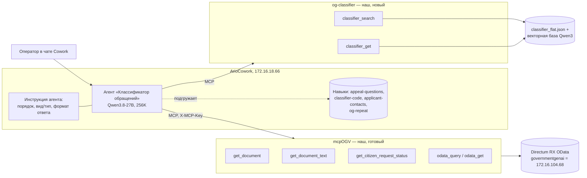
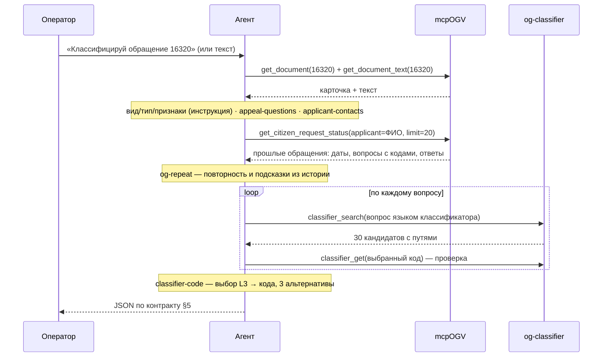

# Агент-классификатор обращений на ArioCowork — проект

Дата: 2026-10-29 · Ветка: `research/quality-followups-68` · Статус: черновик на согласование
Редакция 2: RX-часть — готовый mcpOGV; свой сервер только для поиска по классификатору.

## 1. Зачем

Гипотеза: классификацию обращений граждан (59-ФЗ, Общероссийский классификатор,
2108 рубрик) можно перенести из нашего жёстко зашитого пайплайна в агента на
платформе ArioCowork (LibreChat, Agents API совместим с OpenAI). Что должно стать
лучше — со слов оператора:

1. **Гибкость.** Правила классификации живут в инструкции и навыках агента и
   правятся без кода и пересборки. Сейчас каждое правило аналитика — коммит,
   тесты, обновление стенда.
2. **История системы.** При классификации агент видит прошлое в RX: прежние
   обращения заявителя, их коды и ответы. Наш пайплайн видит только текст одного
   обращения.
3. **Полный контроль над MCP RX.** Мы сами решаем, какие данные RX видит агент и
   что он в RX может сделать. MCP-сервер RX — наш (mcpOGV, репозиторий
   `MCP-Directum-RX`), дорабатываем его сами.

Проверка — вручную, силами оператора: он собирает агента в интерфейсе платформы,
подключает MCP-серверы и прогоняет обращения сам.

## 2. Цели, не-цели, анти-цели

**Цели**
- Инструкция агента и навыки, из которых в интерфейсе ArioCowork собирается агент
  «Классификатор обращений».
- MCP-сервер `og-classifier`: смысловой поиск по классификатору и проверка кода.
- Подключение готового mcpOGV для чтения RX и готового навыка истории `og-repeat`.
- Два варианта подачи классификатора агенту для ручного сравнения (§6).
- Чек-лист ручной проверки на тех же выборках, что и пайплайн.

**Не-цели (в этой итерации)**
- Запись в RX и доставка ответа агента в RX. Результат оператор видит в чате;
  мост «RX → Agents API → проверка JSON и кодов → RX» — следующая итерация, если
  гипотеза подтвердится.
- Доработки mcpOGV. Берём его как есть; что понадобится — отдельной задачей в его
  репозитории.
- Поиск похожих документов (отдельная фича, отдельный индекс).
- Многоагентная оркестрация, расписания, блоки вызова агента в маршрутах RX.
- Автоматический прогон eval через Agents API — оператор тестирует вручную.
- Перенос в `main` и на стенд.

**Анти-цели — провал, даже если «работает»**
- Агент выдаёт коды, которых нет в классификаторе, или код не той ступени.
- Ответ дольше 2 минут на типовое обращение.
- Агент пишет в RX или видит больше, чем нужно для классификации.
- Персональные данные из обращений уходят за пределы внутренней сети.

## 3. Ограничения и факты

- **Платформа** — внутри сети: `cowork.directum360.ru` → `172.16.18.66`, отвечает
  напрямую без прокси. Agents API: `https://cowork.directum360.ru/api/agents/v1/chat/completions`,
  `Authorization: Bearer <ключ>`, `model` = ID агента (обязателен).
- **Модель** за агентом — Qwen3.8-27B (Ario), окно 256K.
- **Базовый контекст** агента «ОГВ» — ~35K токенов (инструкция + вложения); один
  вызов MCP-инструмента поднял запрос до ~70K. Новый агент — без лишних вложений.
- **Инструменты из запроса не работают:** функции из `tools` запроса агент
  игнорирует; вызывает только инструменты, подключённые на платформе.
- **Ответ агента** — только текст `choices[0].message.content`; строгий JSON по
  инструкции + `response_format: json_object` работает (проверено).
- **Навыки на платформе:** имя в kebab-case, описание «когда применять», инструкции
  в markdown, файлы (zip). Модель видит описания и подгружает навык сама. У агента
  отдельно есть системная инструкция — она в контексте всегда.
- **Ограничения стенда платформы:** PDF на локальной модели не доходит до модели;
  лимиты RAG. Текст документа агент получает через MCP строкой, не файлом.
- **RX** — один стенд с двумя адресами: `governmentgenai.directum360.ru` =
  `172.16.104.68`; сервис интеграции OData, Basic-авторизация.
- **mcpOGV** (`MCP-Directum-RX`, ветка `feature/mcp-ogv`): FastAPI + MCP, streamable
  HTTP `http://<хост>:8010/mcp`; доступ по общему секрету `X-MCP-Key`; учётка RX —
  личная (логин и пароль передаёт платформа) или служебная; запись выключена по
  умолчанию и идёт через подтверждение; тулы обращений не отдают адрес, телефон и
  email заявителя. Порт 8010 совпадает с портом нашего классификатора — на одной
  машине одному из них нужен другой порт.
- **Прокси в окружении** перехватывает внутренние адреса — `og-classifier` ходит
  наружу только за моделью эмбеддингов при первой загрузке; дальше работает
  офлайн.
- **ПДн (59-ФЗ):** обращения — персональные данные; платформа и MCP-серверы внутри
  сети, это допустимо. Логи `og-classifier` не пишут тексты запросов.

## 4. Как устроено

### 4.1 Компоненты



### 4.2 Сценарий классификации



### 4.3 Инструкция агента и навыки

Раскладка: то, что нужно в **каждой** классификации, — в инструкцию агента;
своды правил для конкретного шага — в навыки, и инструкция прямо называет, какой
навык загрузить на каком шаге (на выбор модели не полагаемся).

Тексты пишем по правилам, уже проверенным в пайплайне (`SYSTEM_PROMPT` в
`src/classifier_agent.py` на `main`, правила аналитика по ФИО и email).

**Инструкция агента (всегда в контексте)**

| Блок | Что внутри | Источник правил |
|---|---|---|
| Порядок работы | шаги схемы 4.2; на каком шаге какой навык загрузить и какой инструмент какого сервера вызвать; при сбое инструмента — сказать об этом в ответе, кодов не выдумывать; в RX ничего не создавать | новое |
| Вид, тип, признаки | определения 59-ФЗ (жалоба/заявление/предложение), индивидуальное/коллективное/анонимное, устное, признаки повторного обращения и отзыва | `SYSTEM_PROMPT`, правила 4c/4d |
| Формат ответа | строгий JSON без текста вокруг; поля и лимиты контракта (§5); один код — один вопрос | контракт `/integration/classify-document` |

**Навыки (подгружаются на своём шаге)**

| Навык | Чей | Шаг | Что внутри | Источник правил |
|---|---|---|---|---|
| `appeal-questions` | новый | выделение вопросов | один вопрос = одна проблема или просьба; не дробить одну проблему; как сформулировать вопрос для поиска | правила сегментации пайплайна |
| `classifier-code` | новый | подбор кода, на каждый вопрос | запрос языком классификатора (суть + ключевые фразы + синонимы, как в предобработке `replace`); сначала L3-тема, потом код; типовые разграничения (0096/0097, 0007/0014, 0004/0013, ЖКХ/инфраструктура, дороги/благоустройство); только коды из выдачи `classifier_search`, проверка `classifier_get`; 3 альтернативы; если нужной ветки нет — повторный поиск другой формулировкой | `SYSTEM_PROMPT` (этапы 1–2, правила 1–5), отчёт предобработки |
| `applicant-contacts` | новый | ФИО и email | приоритет источников ФИО, кто не заявитель, именительный падеж; принадлежность адресов, исключение сопроводительного письма и приложений | правила аналитика (раунды 1–2) |
| `og-repeat` | **готовый** (mcpOGV, `docs/skills/og-repeat.zip`) | история, если заявитель известен | прошлые обращения заявителя по тем же кодам в периоде повторности, сверка с флажком «Повторное», ст. 11 59-ФЗ; скрипт `find_repeats.py` | mcpOGV |

Для классификации из `og-repeat` нужны два вывода: повторное ли обращение и
какими кодами раньше классифицировали вопросы того же заявителя. Прошлые коды —
подсказка, не замена своему выбору; прошлые обращения в ответе не пересказываются.
Если ФИО частое (однофамильцы), `og-repeat` сверяет по номеру текущего обращения.

«Гибкость» из §1 — правка инструкции или любого навыка в интерфейсе платформы без
кода; навыки правятся независимо друг от друга.

## 5. Контракт ответа

Тот же, что сейчас получает RX, плюс служебные поля для ручной проверки:

```json
{
  "document_id": 16320,
  "applicant_fio": "Иванов Иван Иванович",
  "applicant_email": "ivanov@example.ru",
  "summary": "до 250 символов",
  "reasoning": "до 1000 символов, по всем вопросам",
  "questions": [{"code": "0003.0009.0097.0699", "question": "формулировка вопроса"}],
  "check": {
    "vid": "Жалоба", "tip": "Индивидуальное",
    "is_repeat_appeal": false, "is_withdrawal_request": false,
    "alternatives": {"0003.0009.0097.0699": ["…", "…", "…"]},
    "history_used": ["рег. № прошлых обращений, на которые опирался"]
  }
}
```

`check` — только для оператора при ручной проверке; в боевом контракте RX его нет.
`applicant_email` агент берёт из текста документа (mcpOGV email заявителя не отдаёт).

## 6. Как агент узнаёт классификатор — два варианта

| | **A. Поиск как инструмент** (основной) | **B. Классификатор в навыке** (для сравнения) |
|---|---|---|
| Как | `classifier_search` в `og-classifier` | zip-навык с файлом всех листьев (код + полный путь) |
| Объём в контексте | ~30 кандидатов на вопрос | ~430 тыс. символов (~150K токенов) с путями; ~160 тыс. без путей |
| Ожидание | быстрее, полнота поиска проверена (правильный код в кандидатах у 55 из 72 при Qwen3 + предобработке) | агент видит всё, но каждый вызов тяжёлый и медленный; риск упереться в лимиты навыков стенда |
| Проверка, что вариант честный | — | перед сравнением спросить агента о трёх кодах из конца файла и о числе рубрик (2108). Не знает — файл режется или идёт через RAG, сравнение A/B не имеет смысла, B снимается |

Почему не `search_citizen_request_classifier` из mcpOGV: он ищет подстроку в
названии рубрики («дорог», «ЖКХ»). По фразе гражданина («муж вернулся из СВО,
выплат нет») подстрокой рубрику не найти — нужен смысловой поиск.

Поиск в варианте A: лучшая проверенная связка — Qwen3-Embedding-0.6B (база
`data/vector_db_qwen3`), плюс лексический поиск, как в пайплайне; запасной — e5 +
адаптер (`data/vector_db_adapted_v3`, в Git). Предобработку запроса делает сам
агент (навык `classifier-code`), отдельный вызов LLM не нужен.

## 7. MCP-серверы

### 7.1 `og-classifier` — новый

| Инструмент | Вход | Выход |
|---|---|---|
| `classifier_search` | `query: str`, `top_k: int = 30` | `[{code, name, level, full_path, score}]` |
| `classifier_get` | `code: str` | `{code, name, level, full_path, parent_code, exists}` |

- Только чтение, к RX не ходит: источник — `data/classifier_flat.json` и векторная
  база. Самостоятельный сервер (своя загрузка модели и базы), без зависимости от
  `ClassifierAgent` — чтобы не тянуть 64-коммитное слияние с `main` в эту ветку.
- Транспорт — streamable HTTP; для прототипа на машине оператора
  `192.168.189.140:8020` (правило брандмауэра «только локальная сеть», как для 8010).
- Доступ — по общему секрету в заголовке, как у mcpOGV (`X-MCP-Key`), секрет в `.env`.
- Логи: инструмент, время, число результатов — без текста запроса.

### 7.2 mcpOGV — готовый, подключаем как есть

Нужные агенту тулы (только чтение):

| Тул | Зачем |
|---|---|
| `get_document`, `get_document_text` | карточка и текст обращения |
| `get_citizen_request_status` | история заявителя (`applicant`) и коды конкретного обращения (`request_id`); на нём работает `og-repeat` |
| `odata_query`, `odata_get` | запасной путь: проверить код в `IQuestions` RX, если понадобится |

Запись (`MCP_WRITE_ENABLED`) не включаем. Остальные тулы mcpOGV агенту не мешают,
но инструкция их не использует.

**Где это в RX** (по `$metadata` стенда, 2026-10-29): обращения — `IRequests`;
заявитель — `Correspondent`, плюс `FullName` и `Email` на карточке; коды —
`Questions` → `Question.FullCode` / `SubQuestion.FullCode`; признак повторности —
`IsRepeated`. На стенде: 1832 обращения, у 1351 есть коды, 153 заявителя с двумя и
более обращениями, 19 помечены повторными — историю есть на чём проверять.

## 8. Ручная проверка (чек-лист оператора)

1. Собрать агента: инструкция + навыки `appeal-questions`, `classifier-code`,
   `applicant-contacts`, `og-repeat`; MCP `og-classifier` и mcpOGV; вариант A.
2. Прогнать выборку из 11 (`tests/fixtures/test_appeals_real12.json`) и
   5 ветеранских (`vet1`–`vet5` в `eval_results/fixtures_ii25_vet.json`, тексты
   синтетические) — **текстом**: у них нет `document_id` на стенде, шаг истории на
   них не проверяется.
3. Историю проверить отдельно — на 3–5 обращениях стенда по `document_id`
   (заявители с прошлыми обращениями; оператор выбирает сам).
4. Для каждого записать: коды агента, совпадение с эталоном, время, использована
   ли история, были ли коды вне классификатора.
5. Повторить с вариантом B (после проверки из §6).
6. Сравнить с колонкой «Qwen3 · предобработка replace» листа «По обращениям» из
   `eval_results/e2e_summary_all.xlsx`.

Шаблон таблицы — xlsx с заполненными id, эталонами и результатами пайплайна,
пустыми колонками для агента.

## 9. Что решено и кем

**Решил оператор**
- Платформа ArioCowork, модель Qwen3.8-27B с окном 256K, платформа во внутренней сети.
- MCP RX — свой (mcpOGV), дорабатывается нами.
- RX-часть — готовый mcpOGV; свой сервер — только для классификатора.
- Тестирование вручную, силами оператора.
- Ветка `research/quality-followups-68`.

**Мои решения (проверьте)**
- Общие правила — в инструкции агента; своды правил по шагам — в навыках;
  инструкция сама называет, какой навык грузить.
- История — готовый навык `og-repeat` вместо своего.
- `og-classifier` — отдельный сервер, а не тул внутри mcpOGV: модель эмбеддингов и
  torch раздули бы mcpOGV.
- Вариант A основной, B — для сравнения.
- Ответ — в чате, со служебным блоком `check`; доставка в RX — следующая итерация.
- `og-classifier` на машине оператора, порт 8020, доступ по `X-MCP-Key`.

**Оставлено исполнителю**
- Библиотека MCP (как в mcpOGV — для единообразия) и структура каталогов.
- Точные формулировки инструкции и навыков в рамках правил §4.3.
- Тесты `og-classifier` (pytest), формат логов.

## 10. Открытые вопросы

- Где развёрнут mcpOGV, который подключён к агенту «ОГВ», и под какой учёткой RX
  он работает — новый агент подключит тот же экземпляр.
