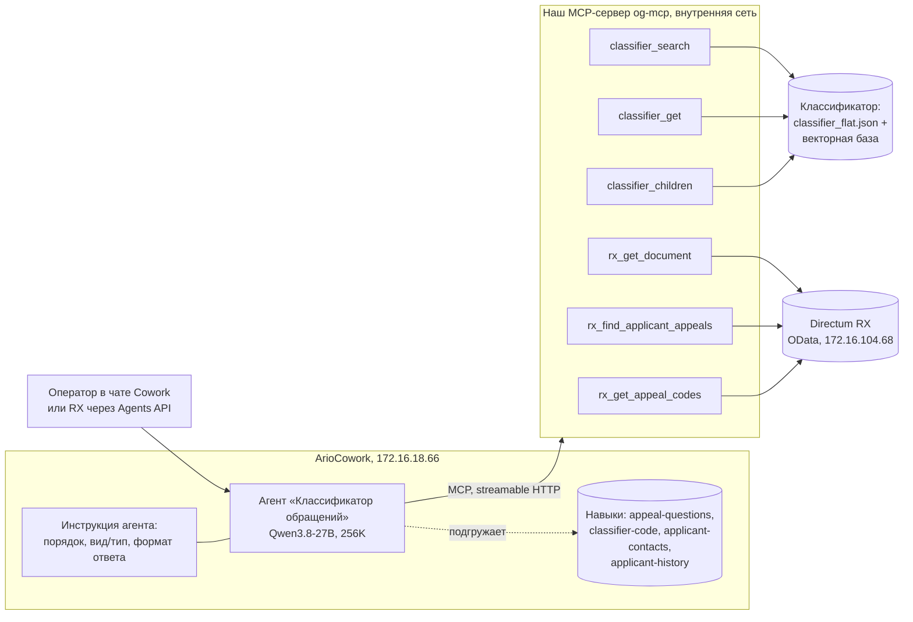
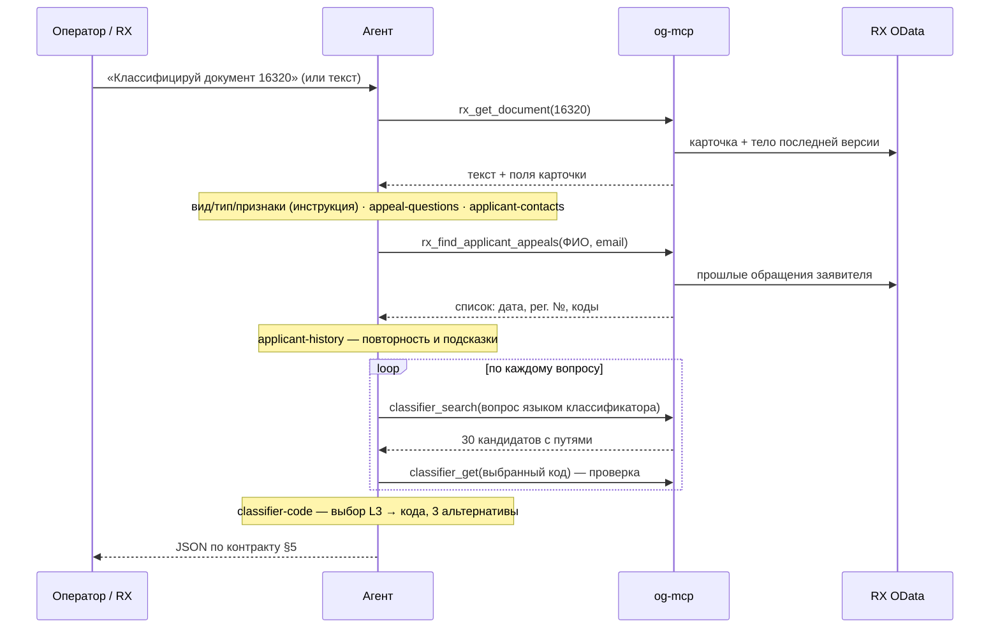

# Агент-классификатор обращений на ArioCowork — проект

Дата: 2026-10-29 · Ветка: `research/quality-followups-68` · Статус: черновик на согласование

## 1. Зачем

Гипотеза: классификацию обращений граждан (59-ФЗ, Общероссийский классификатор,
2108 рубрик) можно перенести из нашего жёстко зашитого пайплайна в агента на
платформе ArioCowork (LibreChat, Agents API совместим с OpenAI). Что должно стать
лучше — со слов оператора:

1. **Гибкость.** Правила классификации живут в навыках агента и правятся без кода
   и пересборки. Сейчас каждое правило аналитика — коммит, тесты, обновление стенда.
2. **История системы.** При классификации агент видит прошлое в RX: прежние
   обращения заявителя и их коды. Наш пайплайн видит только текст одного обращения.
3. **Полный контроль над MCP RX.** Мы сами решаем, какие данные RX видит агент и
   что он в RX может сделать: свой MCP-сервер поверх API RX.

Проверка — вручную, силами оператора: он собирает агента в интерфейсе платформы
из наших навыков, подключает наш MCP-сервер и прогоняет обращения сам.

## 2. Цели, не-цели, анти-цели

**Цели**
- Набор навыков (текстов инструкций), из которых в интерфейсе ArioCowork
  собирается агент «Классификатор обращений».
- MCP-сервер с инструментами: поиск по классификатору и чтение RX (документ,
  история заявителя).
- Два варианта подачи классификатора агенту для ручного сравнения (§6).
- Чек-лист ручной проверки на тех же выборках, что и пайплайн.

**Не-цели (в этой итерации)**
- Запись в RX и доставка ответа агента в RX. В этой итерации результат оператор
  видит в чате; мост «RX → Agents API → проверка JSON и кодов → RX» — следующая
  итерация, если гипотеза подтвердится.
- Поиск похожих документов (отдельная фича, отдельный индекс).
- Многоагентная оркестрация, расписания, блоки вызова агента в маршрутах RX.
- Автоматический прогон eval через Agents API — оператор тестирует вручную.
- Перенос в `main` и на стенд.

**Анти-цели — провал, даже если «работает»**
- Агент выдаёт коды, которых нет в классификаторе, или код не той ступени.
- Ответ дольше 2 минут на типовое обращение.
- Агенту доступны данные RX шире, чем нужно для классификации (все поля, все
  документы, запись).
- Персональные данные из обращений уходят за пределы внутренней сети.

## 3. Ограничения и факты

- **Платформа** — внутри сети: `cowork.directum360.ru` → `172.16.18.66`, отвечает
  напрямую без прокси. Agents API: `https://cowork.directum360.ru/api/agents/v1/chat/completions`,
  `Authorization: Bearer <ключ>`, `model` = ID агента (обязателен).
- **Модель** за агентом — Qwen3.8-27B (Ario), окно 256K.
- **Базовый контекст агента** «ОГВ» — ~35K токенов (инструкция + вложения); один
  вызов MCP-инструмента поднял запрос до ~70K. Для нового агента — без лишних вложений.
- **Инструменты из запроса не работают:** функции, переданные в `tools` запроса,
  агент игнорирует; вызывает только инструменты, подключённые на платформе.
  Значит, всё, что агент делает в RX, — через наш MCP-сервер.
- **Ответ агента** RX получает только как текст `choices[0].message.content`;
  строгий JSON по инструкции + `response_format: json_object` работает (проверено).
- **Ограничения стенда платформы:** PDF на локальной модели не доходит до модели;
  навыки с файлами — только zip; лимиты RAG. Поэтому текст документа агент получает
  через MCP как строку, а не файлом.
- **Прокси в окружении** перехватывает внутренние адреса — MCP-сервер ходит в RX
  с обходом прокси по адресу (как `src/proxy_policy.py`).
- **RX** — стенд `172.16.104.68`, сервис интеграции OData, Basic-авторизация.
  Чтение документа уже есть: `src/rx_client.py` (`IElectronicDocuments`, последняя
  версия, извлечение текста).
- **ПДн (59-ФЗ):** обращения — персональные данные; платформа и MCP-сервер
  внутри сети, это допустимо. Логи MCP-сервера не пишут тексты обращений.

## 4. Как устроено

### 4.1 Компоненты



### 4.2 Сценарий классификации



### 4.3 Инструкция агента и навыки

Как платформа работает с навыками (по интерфейсу ArioCowork): навык — имя в
kebab-case, описание «когда применять», инструкции в markdown и, при необходимости,
файлы. Модель видит описания и подгружает навык, когда считает нужным. У агента
отдельно есть поле системной инструкции — она в контексте всегда.

Отсюда раскладка: то, что нужно в **каждой** классификации, — в инструкцию агента;
подробные своды правил, нужные на конкретном шаге, — в навыки, а инструкция прямо
называет, какой навык загрузить на каком шаге (на выбор модели не полагаемся).

Тексты пишем по правилам, уже проверенным в пайплайне (`SYSTEM_PROMPT` в
`src/classifier_agent.py` на `main`, правила аналитика по ФИО и email).

**Инструкция агента (всегда в контексте)**

| Блок | Что внутри | Источник правил |
|---|---|---|
| Порядок работы | шаги схемы 4.2; на каком шаге какой навык загрузить и какой инструмент вызвать; что делать при сбое инструмента (сказать об этом в ответе, кодов не выдумывать) | новое |
| Вид, тип, признаки | определения 59-ФЗ (жалоба/заявление/предложение), индивидуальное/коллективное/анонимное, устное, признаки повторного обращения и отзыва | `SYSTEM_PROMPT`, правила 4c/4d |
| Формат ответа | строгий JSON без текста вокруг; поля и лимиты контракта (§5); один код — один вопрос | контракт `/integration/classify-document` |

**Навыки (подгружаются на своём шаге)**

| Навык | Шаг | Что внутри | Источник правил |
|---|---|---|---|
| `appeal-questions` | выделение вопросов | один вопрос = одна проблема или просьба; не дробить одну проблему; как сформулировать вопрос для поиска | правила сегментации пайплайна |
| `classifier-code` | подбор кода, на каждый вопрос | запрос языком классификатора (суть + ключевые фразы + синонимы, как в предобработке `replace`); сначала L3-тема, потом код; типовые разграничения (0096/0097, 0007/0014, 0004/0013, ЖКХ/инфраструктура, дороги/благоустройство); только коды из выдачи инструмента, проверка `classifier_get`; 3 альтернативы; если нужной ветки нет в выдаче — `classifier_children` по разделам | `SYSTEM_PROMPT` (этапы 1–2, правила 1–5), отчёт предобработки |
| `applicant-contacts` | ФИО и email | приоритет источников ФИО, кто не заявитель, именительный падеж; принадлежность адресов, исключение сопроводительного письма и приложений | правила аналитика (раунды 1–2) |
| `applicant-history` | история, если есть `document_id` | вызвать `rx_find_applicant_appeals`; повторность — обращение по той же теме за период; прошлые коды — подсказка, не замена своему выбору; не пересказывать прошлые обращения | новое |

«Гибкость» из §1 — правка любого блока или навыка в интерфейсе платформы без
кода; навыки правятся независимо друг от друга.

## 5. Контракт ответа

Тот же, что сейчас получает RX, плюс служебные поля для ручной проверки:

```json
{
  "document_id": 16320,
  "applicant_fio": "Иванов Иван Иванович",
  "applicant_email": "ivanov@example.ru",
  "summary": "до 250 символов",
  "reasoning": "до 1000 символов, по всем вопросам",
  "questions": [{"code": "0003.0009.0097.0699", "question": "формулировка вопроса"}],
  "check": {
    "vid": "Жалоба", "tip": "Индивидуальное",
    "is_repeat_appeal": false, "is_withdrawal_request": false,
    "alternatives": {"0003.0009.0097.0699": ["…", "…", "…"]},
    "history_used": ["рег. № прошлых обращений, на которые опирался"]
  }
}
```

`check` — только для оператора при ручной проверке; в боевом контракте RX его нет.

## 6. Как агент узнаёт классификатор — два варианта

| | **A. Поиск как инструмент** (основной) | **B. Классификатор в навыке** (для сравнения) |
|---|---|---|
| Как | `classifier_search` на нашей векторной базе | zip-навык с файлом всех листьев (код + полный путь) |
| Объём в контексте | ~30 кандидатов на вопрос | ~430 тыс. символов (~150K токенов) с путями; ~160 тыс. без путей |
| Ожидание | быстрее, полнота поиска проверена (правильный код в кандидатах у 55 из 72 при Qwen3 + предобработке) | агент видит всё, но каждый вызов тяжёлый и медленный; риск упереться в лимиты RAG/навыков стенда |
| Проверка, что вариант честный | — | перед сравнением спросить агента о трёх кодах из конца файла и о числе рубрик (2108). Если не знает — файл режется или идёт через RAG, вариант B не показывает весь классификатор и сравнение A/B не имеет смысла; тогда B снимается |
| Что сравнивает оператор | точность и время | точность и время |

Поиск в варианте A: по умолчанию — лучшая проверенная связка (Qwen3-Embedding-0.6B,
база `data/vector_db_qwen3`); запасной — e5 + адаптер (`data/vector_db_adapted_v3`,
в Git). Предобработку запроса делает сам агент (навык `classifier-code`), отдельный вызов LLM
не нужен. Лексический поиск добавляется к векторному, как в пайплайне.

## 7. MCP-сервер `og-mcp`

Один сервер, две группы инструментов. Только чтение.

| Инструмент | Вход | Выход |
|---|---|---|
| `classifier_search` | `query: str`, `top_k: int = 30` | `[{code, name, level, full_path, score}]` |
| `classifier_get` | `code: str` | `{code, name, level, full_path, parent_code, exists}` |
| `classifier_children` | `code_prefix: str` (пусто — разделы L1) | `[{code, name, level}]` дочерние рубрики |
| `rx_get_document` | `document_id: int` | `{document_id, text, filename, card: {reg_number, reg_date, document_kind, correspondent_id, full_name, email, is_repeated}}`; скан без текста — ошибка с понятным текстом |
| `rx_find_applicant_appeals` | `correspondent_id?: int`, `fio?: str`, `email?: str`, `days: int = 365`, `limit: int = 20` | `[{document_id, reg_number, reg_date, subject, is_repeated, codes[]}]` без текстов, плюс `total` — сколько всего нашлось |
| `rx_get_appeal_codes` | `document_id: int` | коды классификатора, присвоенные обращению в RX |

**Где это в RX** (по `$metadata` стенда, 2026-10-29): обращения — набор `IRequests`
(`IRequestDto`, наследник входящего документа). Заявитель — навигация
`Correspondent` (контрагент), плюс строковые `FullName` и `Email` на карточке.
Коды — коллекция `Questions` → `Question.FullCode` / `SubQuestion.FullCode`.
Признак повторности RX уже хранит — `IsRepeated`. Поиск истории — в первую очередь
по `Correspondent/Id` из карточки текущего документа (без омонимов), по `FullName`/
`Email` — только если корреспондента нет. Особенность OData стенда: запрос к
`IRequests` без `$filter` отклоняется («превышено максимальное количество
сущностей») — фильтр нужен всегда.

**Что на стенде для проверки истории:** 1832 обращения, у 1351 есть коды, у 1827 —
корреспондент, 153 корреспондента с двумя и более обращениями, 19 помечены
повторными. У одного корреспондента 184 обращения — похоже на общую запись-заглушку
(аноним или неизвестный): если у заявителя больше `limit` обращений, инструмент
отдаёт `total` и последние `limit`, а навык `applicant-history` считает такую историю
неинформативной.

- Транспорт — streamable HTTP. Для прототипа сервер работает на машине оператора
  (`192.168.189.140:8020`, правило брандмауэра «только локальная сеть», как для 8010);
  в платформе подключается как пользовательский MCP-сервер (поле URL).
- Авторизация — API-ключ: платформа передаёт его из поля «API Key» настройки
  MCP-сервера, `og-mcp` сверяет с ключом из `.env` и без него не отвечает. Иначе
  любой в сети читал бы RX через служебную учётку.
- `rx_get_document` и `rx_get_appeal_codes` отдают только документы разрешённых
  видов (список в `.env`, по умолчанию — вид «обращение» слоя ОГВ) и только поля
  из таблицы; остальное — отказ с понятным текстом.
- Доступ к RX — отдельная служебная учётка с правом чтения нужных сущностей;
  учётные данные — в `.env`, не в навыках и не в платформе.
- Логи: имя инструмента, `document_id`, время, число результатов. Без текстов
  обращений и без ФИО.
- Обход системного прокси для RX — по правилу `uses_env_proxy` из `src/proxy_policy.py`
  на `main` (в этой ветке файла нет — перенести функцию в сервер).

## 8. Ручная проверка (чек-лист оператора)

1. Собрать агента: инструкция + 4 навыка, MCP `og-mcp` (URL и API-ключ), вариант A.
2. Прогнать выборку из 11 (`tests/fixtures/test_appeals_real12.json`) и
   5 ветеранских (`vet1`–`vet5` в `eval_results/fixtures_ii25_vet.json`, тексты
   синтетические) — **текстом**: у них нет `document_id` на стенде, шаг истории на
   них не проверяется.
3. Историю проверить отдельно — на 3–5 документах стенда, которые оператор
   выберет по `document_id` (заявители с прошлыми обращениями).
4. Для каждого записать: коды агента, совпадение с эталоном, время, использована
   ли история, были ли коды вне классификатора.
5. Повторить с вариантом B (после проверки из §6).
6. Сравнить с колонкой «Qwen3 · предобработка replace» листа «По обращениям» из
   `eval_results/e2e_summary_all.xlsx`.

Шаблон таблицы для записи результатов — xlsx с заполненными id, эталонами и
результатами пайплайна, пустыми колонками для агента.

## 9. Что решено и кем

**Решил оператор**
- Платформа ArioCowork, модель Qwen3.8-27B с окном 256K, платформа во внутренней сети.
- Свой MCP-сервер поверх API RX.
- Тестирование вручную, силами оператора.
- Ветка `research/quality-followups-68`.

**Мои решения (проверьте)**
- Общие для каждой классификации правила — в инструкции агента, своды правил по
  шагам — в 4 навыках; инструкция сама называет, какой навык грузить.
- В этой итерации ответ — в чате; доставка в RX — следующая итерация.
- MCP-сервер на машине оператора, авторизация по API-ключу, белый список видов
  документов и полей.
- Один MCP-сервер на обе группы инструментов, порт 8020, только чтение.
- Вариант A основной, B — для сравнения.
- История — прошлые обращения того же заявителя за 365 дней и их коды; похожие
  обращения других заявителей — нет (это фича «поиск похожих документов»).
- Служебный блок `check` в ответе для ручной проверки.
- MCP-сервер самостоятельный (своя загрузка базы и модели эмбеддингов), без
  зависимости от `ClassifierAgent` — чтобы не тянуть 64-коммитное слияние с `main`
  в исследовательскую ветку.

**Оставлено исполнителю**
- Библиотека MCP-сервера (FastMCP или официальный SDK) и структура каталогов.
- Точные формулировки навыков в рамках правил §4.3.
- Тесты MCP-инструментов (pytest), формат логов.

## 10. Открытые вопросы

- Какая учётка RX будет у MCP-сервера (для прототипа — та же, что у классификатора,
  из `.env`).
